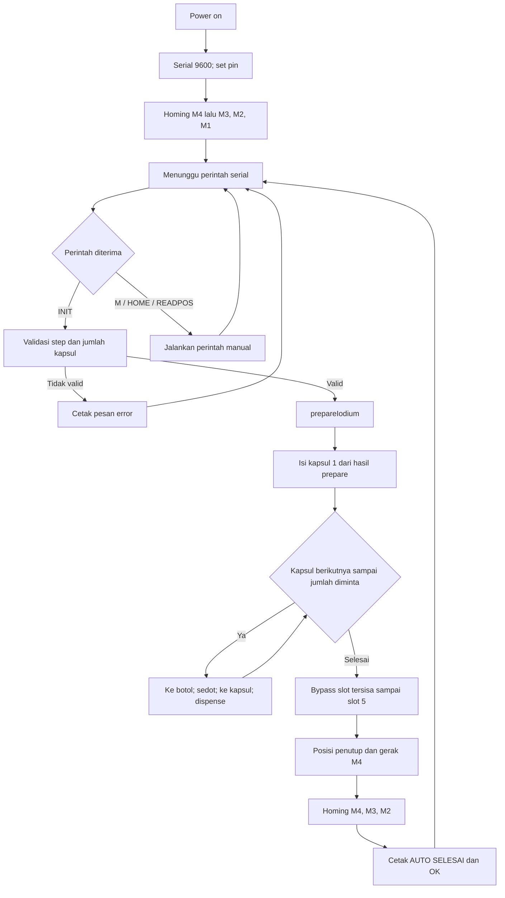

# Dokumentasi I-131 Single Fill / Single Dispense v6

Dokumentasi ini menjelaskan sketch `I_131_SingleFillSingleDispense_v6.ino`, yang mengendalikan empat motor stepper melalui perintah serial untuk homing, persiapan cairan, pengisian kapsul, dan penutupan mekanis.

> **Catatan keselamatan:** dokumen ini menerangkan perilaku program, bukan validasi dosis, desain keselamatan, atau persetujuan untuk penggunaan klinis/radiologis. Sistem dan prosedur harus divalidasi oleh personel yang berwenang sebelum digunakan. Pastikan interlock dan penghentian darurat perangkat keras tersedia.

## 1. Ringkasan fungsi

Program menerima perintah melalui Serial pada **9600 baud**. Saat dinyalakan, Arduino melakukan homing motor dengan urutan **M4 → M3 → M2 → M1**. Setelah itu, program menunggu perintah berbentuk teks yang dibungkus tanda `<` dan `>`.

Perintah utama `<INIT:stepsPerCapsule;jumlahCapsule>` menjalankan urutan otomatis:

1. Memeriksa jumlah kapsul (1–5) dan jumlah step per kapsul (> 0).
2. Menyiapkan sistem dengan `prepareIodium()`; gerakan M2 dan M3 memposisikan mekanisme dan melakukan priming.
3. Menjalankan `runAutoDispense()`; mengisi kapsul pertama dari hasil prepare, lalu mengambil cairan dan mengisi kapsul berikutnya sesuai jumlah yang diminta.
4. Melewati slot kapsul yang tidak digunakan, melakukan gerakan penutup, lalu homing otomatis M4, M3, dan M2.
5. Mengirim respons serial `OK: INIT Accepted` setelah seluruh urutan selesai.

Gerakan berjalan secara blocking: Arduino tidak memproses perintah lain sampai urutan gerakan yang sedang berjalan selesai.

## 2. Konfigurasi pin Arduino

| Fungsi | Pin Arduino | Penggunaan dalam sketch |
|---|---:|---|
| STEP bersama | 7 | Pulsa step dikirim ke driver motor yang sedang diaktifkan. |
| DIR bersama | 6 | Arah gerak untuk motor yang sedang diaktifkan. |
| ENABLE M1 | 8 | Enable driver motor 1; `LOW` berarti aktif dan `HIGH` berarti nonaktif. |
| ENABLE M2 | 9 | Enable driver motor 2; aktif-low. |
| ENABLE M3 | 10 | Enable driver motor 3; aktif-low. |
| ENABLE M4 | 11 | Enable driver motor 4; aktif-low. |
| Limit M1 | 3 | Input homing M1 dengan `INPUT_PULLUP`. |
| Limit M2 | 4 | Input homing M2 dengan `INPUT_PULLUP`. |
| Limit M3 | 5 | Input homing M3 dengan `INPUT_PULLUP`. |
| Limit M4 | 2 | Input homing M4 dengan `INPUT_PULLUP`. |
| Serial | TX/RX bawaan board | Komunikasi perintah dan status, 9600 baud. |

Karena setiap driver berbagi pin STEP dan DIR, pemilihan motor dilakukan dengan mengaktifkan pin ENABLE motor yang bersangkutan. Input limit memakai pull-up internal; kode menganggap limit **belum aktif saat terbaca `HIGH`** dan berhenti mencari home saat input menjadi `LOW`. Pastikan jenis sakelar dan wiring sesuai asumsi ini.

### Arah homing

Nilai konfigurasi `homingDir` untuk M1–M4 adalah `{1, 1, 0, 0}`. Di dalam kode, nilai `1` mengatur DIR `HIGH`, sedangkan `0` mengatur DIR `LOW`. Arti fisik maju/mundur bergantung pada wiring motor dan driver.

### Pemetaan fungsi motor

Pemetaan mekanis berikut disimpulkan dari urutan gerak di sketch; cocokkan dengan mesin aktual:

| Motor | Peran yang tampak dari urutan program |
|---|---|
| M1 | Pemindah/indexer posisi kapsul dan posisi penutup. |
| M2 | Plunger/syringe untuk menyedot atau mengeluarkan cairan. |
| M3 | Pemosisi syringe/nozzle antara area botol dan kapsul. |
| M4 | Mekanisme penutup kapsul. |

## 3. Parameter mekanis dan status

| Nama | Nilai awal | Keterangan |
|---|---:|---|
| `stepsPerRev` | 1600 | Dideklarasikan sebagai step per putaran; tidak dipakai oleh alur program saat ini. |
| `leadMotor1_mmPerRev` | 2.0 | Data lead screw M1; belum digunakan untuk menghitung gerakan. |
| `leadMotor2_mmPerRev` | 1.0 | Data lead screw M2; belum digunakan untuk menghitung gerakan. |
| `leadMotor3_mmPerRev` | 1.0 | Data lead screw M3; belum digunakan untuk menghitung gerakan. |
| `leadMotor4_mmPerRev` | 8.0 | Data lead screw M4; belum digunakan untuk menghitung gerakan. |
| `jumlahCapsule` | 0 | Jumlah kapsul yang diisi; ditetapkan oleh perintah INIT. |
| `stepsPerCapsule` | 0 | Step plunger per kapsul; diterima langsung dari nilai pertama perintah INIT. |
| `totalVolumeSteps` | 0 | Hasil perkalian step per kapsul dan jumlah kapsul; hanya ditampilkan, tidak mengendalikan gerakan. |
| `volumePerCapsule_uL` | 0 | Variabel volume dalam µL; tidak diisi atau dipakai untuk konversi dalam sketch ini. |
| `posAbs[1..4]` | 0 | Estimasi posisi relatif terhadap home, diperbarui oleh fungsi gerak. |
| `homingOffset[1..4]` | 0 | Jumlah pulsa yang tercatat selama homing; tidak digunakan untuk menentukan target gerak otomatis. |

Walaupun komentar dan pesan serial menyebut “volume”, input INIT yang dipakai program sebenarnya adalah **jumlah step**, bukan volume dalam µL. Konversi µL ke step harus dilakukan di HMI atau ditambahkan secara eksplisit di firmware.

## 4. Protokol serial

### Format perintah

Perintah dikirim sebagai teks dalam kurung sudut. Akhir baris newline atau karakter `>` menandai data serial siap diproses. Beberapa perintah yang sudah dibungkus dapat berada dalam satu buffer, misalnya `<M2;1000;0><READPOS>`.

#### Inisialisasi dan siklus otomatis

`<INIT:stepsPerCapsule;jumlahCapsule>`

Contoh: `<INIT:20330;4>` meminta 20.330 step per kapsul untuk 4 kapsul. Nilai kapsul yang diterima adalah 1 sampai 5; nilai step harus lebih dari 0.

#### Gerakkan motor langsung

`<MnomorMotor;jumlahStep;arah>`

- `nomorMotor`: 1–4.
- `jumlahStep`: nilai langkah yang diberikan ke fungsi gerak.
- `arah`: `0` menghasilkan DIR LOW dan pembaruan posisi bertambah; `1` menghasilkan DIR HIGH dan pembaruan posisi berkurang.

Contoh: `<M2;154000;0>`.

#### Homing manual

- `<HOME:ALL>` melakukan homing M4 → M3 → M2 → M1 dan mencetak rekap jumlah pulsa.
- `<HOME:n>` melakukan homing untuk motor `n` (1–4).

#### Baca estimasi posisi

`<READPOS>` mencetak `posAbs` motor 1–4. Nilai ini merupakan hitungan internal berbasis perintah gerak, bukan pengukuran encoder.

### Respons dan validasi

Sketch mencetak status homing, tahapan prepare/dispense, posisi, serta beberapa pesan error seperti `ERR: INIT Format Wrong`, `ERR: INIT Value Out of Range`, `Format M invalid`, dan `Motor invalid`. Parser mengabaikan teks di luar pasangan `<...>`.

## 5. Alur kerja (logic flow)

## 6. Rincian urutan otomatis

### 6.1 Persiapan (`prepareIodium`)

Urutan perintah motor yang dijalankan:

1. M2: `113000` step, arah `0` — posisi plunger ke posisi kosong sesuai komentar program.
2. M3: `135000` step, arah `1` — memosisikan mekanisme ke dalam botol iodium.
3. M2: `stepsPerCapsule` step, arah `1` — priming awal.
4. M3: `110000` step, arah `0` — keluar dari botol dan kembali standby.

### 6.2 Pengisian kapsul (`runAutoDispense`)

Konstanta posisi indexer yang dipakai:

- Botol: `POS_BOTOL = 0` (dideklarasikan tetapi tidak dipakai dalam perhitungan target).
- Kapsul 1: `POS_KAPSUL1 = 31500`.
- Jarak antarkapsul: `JARAK_KAPSUL = 16000`.
- Jumlah slot: `TOTAL_SLOT = 5`.
- Kapsul 5: `95500`.
- Posisi penutup: `227500`.

Urutannya:

1. **Kapsul 1:** M1 bergerak ke posisi 31.500; M3 turun/masuk ke posisi dispense dengan 55.000 step; M2 mengeluarkan cairan sebanyak `stepsPerCapsule`; M3 kembali dengan 55.000 step.
2. **Kapsul 2 hingga jumlah yang diminta:** M1 kembali menuju posisi asal berdasarkan `posAbs[1]`; M3 bergerak ke botol; M2 menyedot sebanyak `stepsPerCapsule`; M3 keluar dari botol; M1 bergerak ke slot kapsul terkait; M3 menuju posisi dispense; M2 mengeluarkan cairan; M3 kembali.
3. **Slot tersisa:** M1 bergerak melewati slot yang tidak diminta sampai slot 5 tanpa dispense.
4. **Penutup:** M1 bergerak ke posisi 227.500 dan M4 bergerak 16.000 step arah `1`.
5. **Homing akhir:** homing dilakukan untuk M4, M3, dan M2. Homing M1 dikomentari/nonaktif pada bagian ini.

## 7. Fungsi utama

| Fungsi | Tanggung jawab |
|---|---|
| `setup()` | Membuka Serial, mengatur pin, melakukan homing awal M4 → M3 → M2 → M1. |
| `loop()` | Memproses buffer saat `stringComplete` bernilai true. |
| `serialEvent()` | Mengumpulkan karakter serial hingga newline atau `>`. |
| `processQueue(data)` | Mencari pasangan `<...>` dan meneruskan isi setiap perintah ke `executeCommand()`. |
| `executeCommand(cmd)` | Menangani perintah M, INIT, HOME, dan READPOS. |
| `homingMotor(id)` | Mengaktifkan driver, bergerak menuju limit, mundur 50 pulsa, mencari limit lagi, lalu menonaktifkan driver. |
| `stepPulse(delayUs)` | Membuat satu siklus pulsa HIGH/LOW dengan jeda mikrodetik. |
| `moveMotorAccel(id, langkah, arah)` | Mengaktifkan motor dan menjalankan bagian percepatan, kecepatan tetap, perlambatan, lalu memperbarui estimasi posisi. |
| `prepareIodium()` | Menjalankan urutan persiapan/priming. |
| `runAutoDispense()` | Menjalankan pipeline pengisian, bypass slot, penutupan, dan homing akhir. |
| `getValue()` / `getValueLong()` | Utilitas mengambil angka setelah label; dipertahankan dalam sketch, tetapi salah satunya digunakan untuk membaca nomor pada HOME. |

## 8. Catatan implementasi dan hal yang perlu diperiksa

1. **Pulsa aktual tidak sama dengan parameter `langkah`.** Pada `moveMotorAccel()`, jumlah pulsa dihitung sebagai dua bagian percepatan/perlambatan masing-masing sekitar `langkah/8`, ditambah cruise `langkah/2`. Untuk langkah besar, totalnya sekitar `3/4 × langkah`, bukan `langkah`. Tinjau rumus ini sebelum mengandalkan posisi atau volume berdasarkan step.
2. **Homing tidak memiliki timeout.** Jika limit switch tidak pernah terbaca LOW, loop homing berjalan terus. Pertimbangkan timeout dan penanganan fault.
3. **Tidak ada debounce atau verifikasi sensor tambahan** untuk input limit di sketch.
4. **Gerak otomatis bersifat blocking dan tidak dapat dibatalkan lewat parser** saat sedang berlangsung. Implementasikan emergency stop secara independen pada perangkat keras jika dibutuhkan.
5. **`stepsPerCapsule` dipakai langsung sebagai langkah motor**, tanpa konversi dari µL. Nilai harus dikalibrasi dan divalidasi pada perangkat yang sebenarnya.
6. **Estimasi `posAbs` bukan umpan balik posisi.** Tidak ada encoder; kehilangan langkah atau gerakan manual dapat membuat nilai internal berbeda dari posisi mekanis.
7. **Perintah arah/step tidak divalidasi secara menyeluruh.** Perintah M membatasi nomor motor, namun tidak membatasi arah ke 0/1 atau memeriksa jumlah step negatif.
8. **Posisi yang diminta motor M1 bergantung pada `posAbs[1]`.** Perubahan metode gerak atau ketidaksesuaian pulsa dapat menyebabkan target kapsul dan penutup meleset.
9. **`volumePerCapsule_uL`, data lead screw, `stepsPerRev`, dan `POS_BOTOL` tidak dipakai dalam kalkulasi gerak** pada versi ini.
10. **Kapasitas otomatis dibatasi lima slot.** Validasi jumlah kapsul membatasi 1–5 dan alur bypass mengacu ke `TOTAL_SLOT = 5`.

Dokumentasi ini mengikuti implementasi sketch saat ini. Jika urutan mekanis, wiring, atau parameter firmware berubah, dokumentasi perlu diperbarui dan prosesnya diuji ulang.
